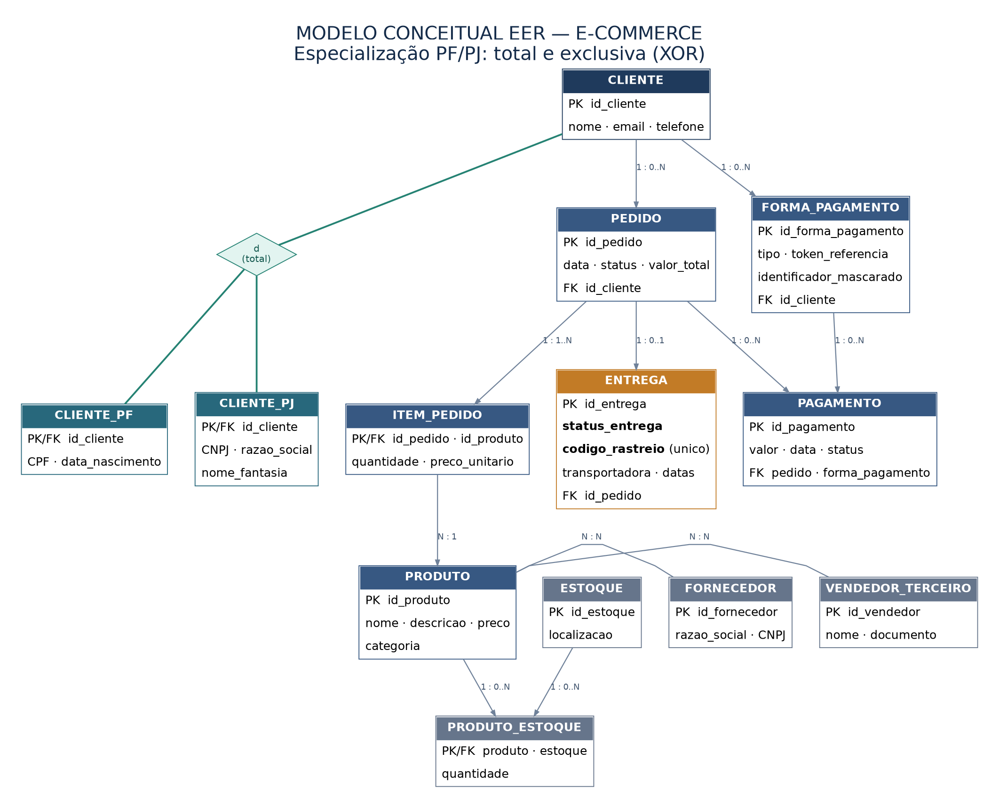

# Projeto de Banco de Dados — E-commerce

## Sobre o projeto

Esse projeto faz parte do desafio de modelagem de banco de dados. O objetivo foi criar e refinar um modelo conceitual para um sistema de e-commerce, pensando em como as informações de uma loja virtual se relacionam.

No modelo, temos clientes, produtos, pedidos, formas de pagamento, entregas e também informações de estoque, fornecedores e vendedores. A ideia foi organizar essas entidades de um jeito que faça sentido para o funcionamento de uma loja online.

## Funcionalidades:

**1. Clientes Pessoa Física e Pessoa Jurídica**

Os clientes foram separados em dois tipos: Pessoa Física (PF) e Pessoa Jurídica (PJ). Os dados em comum ficam na entidade `CLIENTE`, enquanto as informações específicas ficam em `CLIENTE_PF` (como CPF) ou `CLIENTE_PJ` (como CNPJ e razão social). Cada cliente deve pertencer a apenas um desses tipos, nunca aos dois ao mesmo tempo.

**2. Mais de uma forma de pagamento**

Foi adicionada a entidade `FORMA_PAGAMENTO`, permitindo que um mesmo cliente cadastre diferentes opções de pagamento. Os pagamentos realizados nos pedidos são registrados na entidade `PAGAMENTO`.

**3. Acompanhamento das entregas**

Foi incluída a entidade `ENTREGA`, com informações como status da entrega, código de rastreio, transportadora e datas. Assim, é possível acompanhar a situação do envio de um pedido.

## Como as entidades se relacionam?

De forma geral, um cliente pode realizar vários pedidos, e cada pedido pode conter diferentes produtos. O cliente também pode cadastrar várias formas de pagamento. Os pedidos registram seus pagamentos e podem ter uma entrega associada. Já os produtos se relacionam com o estoque, os fornecedores e os vendedores.

## Diagrama do modelo

A imagem abaixo mostra o modelo desenvolvido para o desafio:

## Arquivos do projeto

- `README.md`: descrição do projeto e das alterações feitas.
- `diagrama_eer.png`: imagem do modelo para visualizar facilmente.
- `diagrama_eer.svg`: outra versão da imagem, com melhor qualidade para ampliar.
- `modelo_conceitual.mmd`: versão editável do diagrama em Mermaid.
