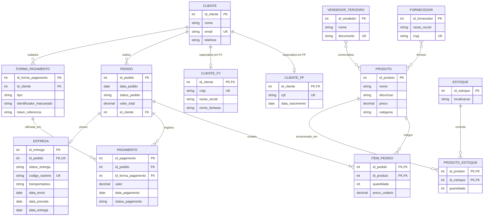

# Desafio de Projeto — Refinamento do Modelo Conceitual EER de E-commerce

## Descrição do projeto

Este projeto apresenta o refinamento de um **modelo conceitual de banco de dados para um e-commerce**, utilizando os conceitos do Modelo Entidade-Relacionamento Estendido (EER). A proposta representa o cadastro de clientes, produtos, pedidos, pagamentos, entregas, estoque, fornecedores e vendedores terceiros.

O refinamento atende a três requisitos: **especialização de clientes em Pessoa Física (PF) ou Pessoa Jurídica (PJ)**, **possibilidade de cadastrar várias formas de pagamento por cliente** e **controle de entregas por status e código de rastreio**.

> **Observação:** como o diagrama original da atividade não foi fornecido, este repositório apresenta uma versão-base de e-commerce, que pode ser adaptada ao modelo apresentado em aula.

## Diagrama conceitual

O código-fonte do diagrama também está em [`modelo_conceitual.mmd`](modelo_conceitual.mmd), em sintaxe Mermaid, para visualização e edição. O GitHub pode renderizá-lo diretamente abaixo:

## Regras de negócio do refinamento

### 1. Cliente PF ou PJ

`CLIENTE` é uma **superclasse**. `CLIENTE_PF` e `CLIENTE_PJ` são **subclasses** que herdam o identificador do cliente e possuem atributos específicos:

- **Pessoa Física:** CPF e data de nascimento.
- **Pessoa Jurídica:** CNPJ, razão social e nome fantasia.

A especialização é **total e disjunta (exclusiva)**: **todo cliente pertence a exatamente uma subclasse**, PF **ou** PJ, **nunca às duas**. A notação de relacionamentos 1:0..1 do diagrama deve ser interpretada em conjunto com esta restrição EER, pois a sintaxe `erDiagram` do Mermaid não expressa sozinha a exclusividade/totalidade.

### 2. Mais de uma forma de pagamento

Um cliente pode cadastrar **zero, uma ou várias** formas de pagamento, registradas em `FORMA_PAGAMENTO` (por exemplo, cartão, Pix ou boleto). Cada forma cadastrada pertence a um único cliente. `PAGAMENTO` representa uma transação associada a um pedido e a uma forma cadastrada; um pedido pode registrar mais de um pagamento.

**Integridade:** a forma usada em um pagamento deve pertencer ao **mesmo cliente** que realizou o pedido. Por segurança, o modelo armazena apenas identificador mascarado e/ou token de referência, não o número completo ou código de segurança do cartão.

### 3. Entrega com status e rastreamento

Um pedido pode ter **zero ou uma entrega** no modelo proposto. A entidade `ENTREGA` inclui `status_entrega` e `codigo_rastreio`, além de transportadora e datas relevantes.

Exemplos de status: `PENDENTE`, `EM_PREPARACAO`, `ENVIADO`, `EM_TRANSITO`, `ENTREGUE` ou `CANCELADO`. O código de rastreio pode ficar vazio até a postagem; quando informado, deve ser único. A restrição de uma entrega por pedido foi adotada para simplificar o projeto e pode ser alterada caso o negócio permita remessas parciais.

## Outras entidades e relacionamentos

| Entidade | Responsabilidade |
| --- | --- |
| `PRODUTO` | Catálogo de produtos comercializados. |
| `PEDIDO` | Compra realizada por um cliente. |
| `ITEM_PEDIDO` | Produtos e quantidades de cada pedido, além do preço no momento da compra. |
| `FORNECEDOR` | Empresas que fornecem produtos; associação N:N com produto. |
| `VENDEDOR_TERCEIRO` | Vendedores externos que podem comercializar produtos; associação N:N com produto. |
| `ESTOQUE` | Localizações físicas ou lógicas que armazenam produtos. |
| `PRODUTO_ESTOQUE` | Associação entre produtos e estoques, com quantidade disponível por local. |

## Cardinalidades principais

- **Cliente → Pedido:** 1:N (um cliente pode realizar vários pedidos; cada pedido pertence a um cliente).
- **Cliente → Forma de pagamento:** 1:N (um cliente pode cadastrar várias formas).
- **Pedido → Pagamento:** 1:N, com zero pagamentos enquanto estiver pendente.
- **Pedido → Entrega:** 1:0..1 (a entrega pode ainda não ter sido criada).
- **Pedido → Produto:** N:N, resolvido por `ITEM_PEDIDO`.
- **Produto → Estoque:** N:N, resolvido por `PRODUTO_ESTOQUE`.
- **Fornecedor → Produto:** N:N.
- **Vendedor terceiro → Produto:** N:N.

## Arquivos do repositório

- `README.md` — contexto, diagrama, alterações e regras de negócio.
- `modelo_conceitual.mmd` — diagrama EER em Mermaid (editável).
- `diagrama_eer.svg` — diagrama vetorial para visualizar no GitHub.
- `diagrama_eer.png` — versão em imagem para apresentação.

## Observações sobre a implementação

Este repositório documenta o **modelo conceitual**. A representação de PK/FK ajuda a visualizar como as entidades poderiam ser relacionadas em um futuro modelo lógico. Na implementação em banco relacional, devem ser adicionadas validações para garantir a especialização exclusiva/total de `CLIENTE`, a correspondência entre cliente e forma de pagamento e a unicidade do rastreio quando preenchido.
